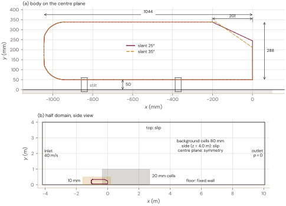
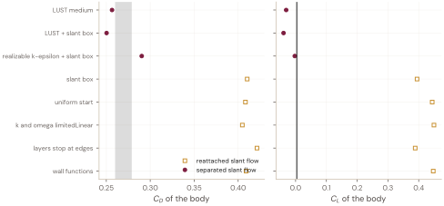
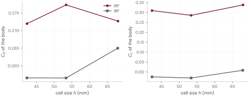
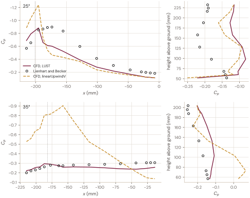

# Ahmed body (3D)

This case checks the 3D setup on the Ahmed body, the standard test shape for the wake of road vehicles,
at slant angles of 25° and 35°. At 25° the flow separates at the roof edge and reattaches on the slant,
held there by two vortices from the slant's side edges. At 35° it separates and does not reattach.

The setup finds both flow states. The drag of the body comes out 3 to 7 % below the two available
measurements at 25° and within 8 % at 35°. The mean wall pressure on roof, slant, base and sides agrees
within ΔC_p = 0.05, except on the 25° slant, where the computed suction is 0.13 too weak. One setting
decided the result. With the convection scheme of the motorBike tutorial the 35° flow stayed attached to
the slant and the drag came out about 50 % too high.



## Experiment

| | |
|---|---|
| Body | 1044 × 389 × 288 mm, slant 222 mm along the surface, four stilts Ø 30 mm, 50 mm ground clearance |
| Flow | 40 m/s (Re_H = 7.7·10⁵), turbulence intensity below 0.25 %, fixed floor |
| Data | wall pressure taps on roof, slant, base and side (Lienhart & Becker 2003, ERCOFTAC case 82) |
| Drag | 0.285 (25°) and about 0.26 (35°) from Ahmed et al. (1984); 0.299 and 0.279 measured by W. Meile at TU Graz at 40 m/s (reported by Möller et al. 2008; see also Meile et al. 2011) |

The nose is the measured DLR surface of the ERCOFTAC data set. It deviates by up to 3 mm from the
R 100 mm circle that many studies use. The long edges are rounded with r ≈ 2.5 mm as in the DLR data,
although the drawing shows them sharp.

## Setup

Half model with a symmetry plane, meshed by `gev.mesh3d` with snappyHexMesh.

| Item | Choice | Reason |
|---|---|---|
| Domain | 3 L ahead, 9.6 L behind, 3.5 L above, 3.6 L beside the body | as the 3D reference case; a smaller first domain had half the volume and gave the same drag |
| Mesh | cubes of 80 mm, surface 5 to 2.5 mm, box around the body 10 mm, wake box 20 mm; 1.5 million cells | |
| Wall | wall functions on body, stilts and floor, 4 layers, y⁺ ≈ 30 to 60 | with 26 to 30 resolved layers (y⁺ ≈ 1) the 25° drag rose from 0.294 to 0.322 |
| Wall functions | nutUSpalding, omegaWallFunction with binomial blending | valid both at y⁺ ≈ 1 and in the log layer |
| Turbulence | k-ω SST | |
| Schemes | LUST for U, upwind for k and ω | see below |
| Solver | SIMPLEC, preset `fast` (relTol as the motorBike tutorial) | on the same mesh `fast` and `strict` gave C_d 0.356 and 0.358 after 200 iterations, `strict` took 7 times longer per iteration |
| Start | potentialFoam | |
| Stop and mean | force rules of `gev.convergence`; mean over the last window of 400 to 667 iterations; pMean from iteration 400 | 25° settled after 2014 iterations, 35° swings and ran to 3000 |

C_d and C_l refer to the full frontal area of 0.112 m² and cover the body without the stilts.

### Why LUST

With linearUpwindV, the scheme of the motorBike tutorial and of the 2D cases, the 35° flow separated in a
bubble and reattached on the slant: C_d 0.409 instead of about 0.26, C_l 0.44, ΔC_p ≈ −0.3 on roof and
slant. These changes did not help: layers continued over the edges (C_d 0.421), limitedLinear for k and ω
(0.405), a start without potentialFoam (0.408), a finer box of 5 mm over slant and wake (0.410). With
LUST, which blends 75 % linear with 25 % linear upwind, the flow separates (0.257). realizableKE with
linearUpwindV separates as well (0.290). The tutorial scheme damps the side-edge vortices so much that the
separation is decided by numerical damping instead of the flow. At 25° LUST changes little (0.294 to
0.277).



## Verification

Three meshes with cubes of 104, 80 and 61.5 mm, all levels scaled:

| Mesh | Cells | C_d 25° | C_d 35° | C_l 25° | C_l 35° |
|---|---|---|---|---|---|
| coarse | 0.75 M | 0.2727 | 0.2650 | 0.338 | 0.009 |
| medium | 1.50 M | 0.2773 | 0.2565 | 0.286 | −0.031 |
| fine | 2.99 M | 0.2720 | 0.2566 | 0.310 | −0.025 |

The drag converges oscillating, so the GCI does not apply. The spread of the three meshes serves as the
numerical uncertainty: 1.9 % for C_d at 25°, 3.3 % at 35° (only the coarse mesh deviates). The lift
scatters by 17 % at 25° and is not validated.



## Comparison with the experiment

| Slant | C_d CFD | C_d measured | C_l CFD | ΔC_p roof / slant / base / side |
|---|---|---|---|---|
| 25° | 0.277 | 0.285 (Ahmed), 0.299 (TU Graz) | 0.286 | 0.00 / +0.13 / +0.04 / +0.05 |
| 35° | 0.257 | ≈ 0.26 (Ahmed), 0.279 (TU Graz) | −0.03 | −0.03 / +0.02 / +0.05 / +0.02 |

ΔC_p is the mean of C_p,CFD − C_p,exp at the taps of each surface. At 25° the computed flow has the right
structure, a separation bubble at the roof edge and the side vortices, but the suction on the slant is
too weak. At 35° the separated flow swings, and the mean is taken over whole periods.



## What the case does not cover

- The lift, which scatters by 17 % between meshes and has a single measurement without uncertainty.
- Unsteady loads of the wake.
- A moving ground, rotating wheels and walls resolved to y⁺ ≈ 1. The diffuser and wheel cases test those.
- The boundary layer of the tunnel floor at the model (the ERCOFTAC inlet profiles are not used).

## Running it

The nose surface has to be downloaded first, see [SOURCES.md](SOURCES.md).

```
python cases/ahmed/run_ahmed.py mesh  --slant 25 --name wf_lust
python cases/ahmed/run_ahmed.py solve --slant 25 --name wf_lust
cd $GEV_RUNS/ahmed/ahmed25_wf_lust && reconstructPar -latestTime -fields '(pMean)' && cd -
python cases/ahmed/compare_pressure.py $GEV_RUNS/ahmed/ahmed25_wf_lust --slant 25 --field pMean
```

1.5 million cells took 0.5 to 0.65 s per iteration with 8 MPI processes.
Grid study: `--cell 0.104` and `--cell 0.0615` with names `wf_lust_c` and `wf_lust_f`. The validated runs
were made with an earlier version of `mesh3d` that differed in two settings without effect on them: the
point for `locationInMesh` (any point in the fluid gives the same mesh) and residual limits of 1e-4 / 1e-5
that none of the runs reached.
