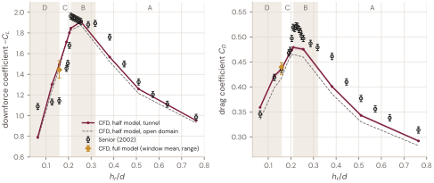
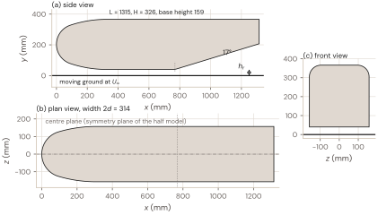
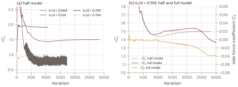
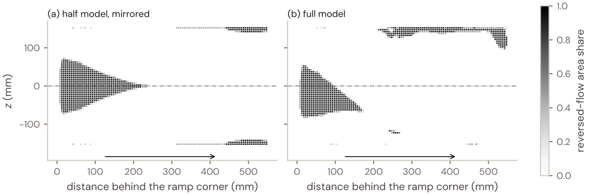

# Diffuser bluff body over a moving ground (3D)

This case checks the 3D setup on the bluff body with a 17° underbody diffuser that Senior (2002) tested
over a rolling road at ten ride heights. It is the first 3D case with a moving ground and with walls
resolved to y⁺ ≈ 1.

Senior describes four flow regimes. Coming down from large heights the downforce rises (A), a separation
bubble forms at the start of the ramp (B), and below the force maximum the flow in the diffuser separates
on one side only and the downforce collapses (C, D). In regimes A and B the computation follows the
measured curve: the downforce coefficient deviates by 0.106 root mean square, 6.7 % of the mean measured
value, and always on the low side; the drag is 4 to 13 % too low. Below the maximum the half model keeps
the flow symmetric, so the collapse comes about 6 mm too low and the downforce is overestimated by up to
31 %. For a design near the force maximum the steady half model is therefore not enough.



## Experiment

| | |
|---|---|
| Body | length 1315 mm, width 2d = 314 mm, height 326 mm, 17° ramp, side plates along the diffuser |
| Flow | 20 m/s (Re_l = 1.8·10⁶), turbulence intensity 0.2 %, rolling road at freestream speed |
| Facility | University of Southampton, 2.1 m × 1.5 m tunnel, blockage 2.86 % (not corrected) |
| Data | C_L and C_D over h_r/d (Fig. 9), uncertainty ±0.028 in C_L and ±0.0038 in C_D at C_L = −2 |

Near the transition from B to C the measured flow switched at random between the two states, and
Ruhrmann & Zhang (2003) found a hysteresis: lowering the model keeps the high downforce longer, a tunnel
start at a fixed height always lands on the low branch.

`diffuser_body.py` builds the model as the intersection of the three views of Senior's Fig. 4. Three
details are not given as numbers and are assumed: the plan view of the nose uses the same radii as the
side view, the ramp starts 546 mm ahead of the base (where 17° and the 159 mm base meet), and the side
plates are 5 mm thick. The support struts on top are not modelled.



## Setup

Half model, `casetools.mesh3d` with the profile `DIFFUSER` of `run_diffuser.py`.

| Item | Choice | Reason |
|---|---|---|
| Domain | cross-section of the Southampton tunnel, side walls and roof as slip walls | a first sweep in the open template domain gave 2.5 to 4.6 % less downforce and 4.3 to 7.2 % less drag at the three lowest heights |
| Underbody | flat bottom, ramp and inner side plates: surface 2.5 mm, 21 layers from 18 µm (y⁺ ≈ 1) | |
| Rest of the body | wall functions, 4 layers | |
| Layer addition | in one pass (`nOuterIter 1`) | with three passes the thinnest layers failed the quality checks and the first cell grew to 66 µm |
| Gap box | cells of at most h_r/8 under the body | at least 8 cells across the gap |
| Diffuser box | 5 mm from 0.1 m ahead of the ramp to 0.4 m behind the base | |
| Ground | moving wall at 20 m/s | rolling road |
| Turbulence, schemes | k-ω SST, LUST for U, as the Ahmed case | |
| Stop and mean | force rules of `casetools.convergence`, no residual limit | with a residual limit of 1e-4 the runs stopped at 640 to 840 iterations while C_L still drifted by 0.5 to 1.4 % |

The meshes have 2.5 to 6.7 million cells; the lowest heights need the most because of the gap box.
C_L keeps Senior's sign (negative is downforce) and refers to the frontal area of 0.1008 m².

## Verification

Grid study at h_r/d = 0.255 with cubes of 104, 80 and 61.5 mm (1.5, 2.5 and 4.8 million cells): C_L
spreads by 0.21 %, C_D by 0.75 %, far below the deviation from the experiment. On flat bottom and ramp the median y⁺ is 0.73 and 0.77, 62 to 67 % of the area lies
below 1; on the side plates the median is 9.



## Comparison with the experiment

Senior Fig. 9; deviation as CFD/measurement − 1:

| h_r/d | Regime | C_L CFD | C_L measured | Deviation | C_D CFD | C_D measured | Deviation |
|---|---|---|---|---|---|---|---|
| 0.064 | D | −0.791 | −1.088 | −27 % | 0.359 | 0.346 | +4 % |
| 0.127 | D | −1.302 | −1.131 | +15 % | 0.422 | 0.419 | +1 % |
| 0.159 | D | −1.496 | −1.143 | +31 % | 0.436 | 0.435 | 0 % |
| 0.191 | C | −1.712 | −1.457 | +18 % | 0.464 | 0.468 | −1 % |
| 0.204 | C | −1.801 | −1.679 | +7 % | 0.474 | 0.497 | −5 % |
| 0.210 | B | −1.846 | −1.962 | −6 % | 0.479 | 0.519 | −8 % |
| 0.255 | B | −1.909 | −1.911 | 0 % | 0.475 | 0.497 | −4 % |
| 0.382 | A | −1.567 | −1.759 | −11 % | 0.401 | 0.461 | −13 % |
| 0.510 | A | −1.257 | −1.325 | −5 % | 0.343 | 0.377 | −9 % |
| 0.764 | A | −0.953 | −0.984 | −3 % | 0.292 | 0.314 | −7 % |

Root mean square error:

| Heights | n | C_L | C_D |
|---|---|---|---|
| all | 10 | 0.194 | 0.028 |
| A and B (h_r/d ≥ 0.21) | 5 | 0.106 | 0.038 |
| C and D (h_r/d < 0.21) | 5 | 0.254 | 0.012 |

The computed maximum lies at h_r/d = 0.255, the measured one at 0.210. Between 0.210 and 0.159 the
measured downforce falls by 42 %, the computed one by 19 %; the computation reaches the measured value of
0.159 only at 0.196. The drag deficit in regimes A and B is not explained by the supports, which Senior
corrected for. A too weak base suction, as on the Ahmed body, is the likely cause but was not checked.



### Full model at h_r/d = 0.159

Without the symmetry plane (5.7 million cells) the flow turns asymmetric by itself: the side force grows
from iteration 1500 on and the downforce drops with it, from −1.535 to −1.378 at iteration 3000, without
settling. The separation bubble at the ramp start moves to one side, and on the other side the flow
separates along the side plate, as in the experiment. The mean of the last window, C_L = −1.444, cuts
the error from 0.353 to 0.235, but the run is not converged.

## What the case does not cover

- Regimes C and D. A time-resolved computation of the full model would be needed, and it would also
  have to reproduce the hysteresis of the experiment.
- The grid uncertainty at the heights where the flow separates.
- The base pressure (Senior Fig. 20), which could locate the drag deficit.

## Running it

The case needs no third-party files; for the comparison plot see [SOURCES.md](SOURCES.md).

```
python cases/diffuser/run_diffuser.py mesh  --hd 0.255 --procs 8
python cases/diffuser/run_diffuser.py solve --hd 0.255 --procs 8
python cases/diffuser/run_diffuser.py plot
```

A run took 0.9 to 2.3 s per iteration and 800 to 2800 iterations on 8 or 16 cores.
