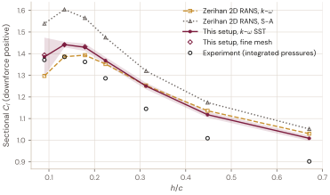
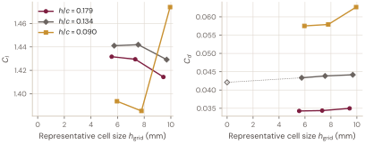
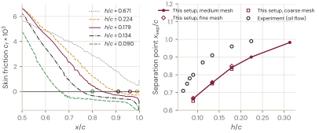
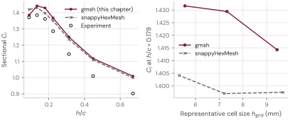

# Tyrrell 026 wing in ground effect (2D)

This case checks the 2D setup on a racing-car front wing above a moving ground, against the wind-tunnel
tests of Zerihan (2001). The single element wing is computed at the seven ground heights of the
pressure-tapped tests, the double element wing at eleven heights of the force tests.

For the single element wing the setup reproduces the rise of downforce and drag towards the ground and
puts the downforce maximum at the measured height. It predicts the sectional lift 1 to 12 % above the
measurement, with the smallest offset closest to the ground. The trailing-edge separation moves forward
as the wing approaches the ground, as in the oil-flow pictures, but it starts 0.09 to 0.15 chord lengths
too early. The most likely reason is that the computation is fully turbulent while the test wing had a
laminar run up to a transition bubble.



## Experiment

| | |
|---|---|
| Wing | main element of the 1998 Tyrrell 026 front wing at 80 % scale, chord c = 223.4 mm, span 1100 mm, end plates |
| Profile | derived from NASA LS(1)-0413 MOD, blunt trailing edge 0.007c |
| Incidence | quoted α = 1°, true incidence 3.45° |
| Flow | 31 m/s (Re_c = 4.6·10⁵ in Zerihan's CFD), turbulence intensity 0.2 %, moving belt |
| Facility | University of Southampton, 2.1 m × 1.7 m tunnel with rolling road |
| Compared | sectional C_l from 45 pressure taps at mid span (Table 15), separation point from oil flow (Table 9), 3D balance forces of the double element wing (Fig. 36b) |

Zerihan calls the pressure-integrated C_l an estimate for trends. The taps miss part of the suction peak
at the leading edge, so the measured value is more likely too low than too high.

## Setup

The mesh comes from gmsh (`gev.mesh2d_gmsh`, profile `TYRRELL`), quad-dominant with prism layers that
run unbroken around the blunt trailing edge. The cell sizes are the snappyHexMesh settings of the 3D Ahmed
reference case, scaled by c/L.

| Item | Choice | Reason |
|---|---|---|
| Domain | leading edge − 8c to trailing edge + 8c, roof at 7c | as in Zerihan's own 2D CFD |
| Background cell | 16.6 mm (Ahmed cell × c/L) | same relative resolution as the 3D reference |
| Surface | c/215 (1.04 mm), trailing edge corners c/860 | snappy level 4 and 6 |
| Gap box | from 0.5c ahead to 1.5c behind the wing, ground to 10 mm above the trailing edge, 1.04 mm | ending the box below the trailing edge left the separated region in coarse cells; cell sizes changed by 2 % then moved C_l by ±0.9 %, with the box by ±0.1 % |
| Nose box | ±10 mm around the leading edge, 0.52 mm | |
| Wall layers | 20 layers from 10 µm, ratio 1.2, on wing and ground | y⁺ ≈ 1 as in Zerihan's CFD |
| Turbulence | k-ω SST, fully turbulent | the experiment has free transition; Zerihan's CFD is fully turbulent too |
| Inlet | Tu = 0.2 %, ν_t/ν = 10 | ν_t/ν is assumed |
| Ground | moving wall at 31 m/s | rolling road |
| Roof | zeroGradient | Zerihan: extrapolation |
| Schemes | linearUpwindV for U, upwind for k and ω, SIMPLEC | |
| Convergence | residuals p 1e-5, U/k/ω 1e-6, at most 4000 iterations; mean over the last 200 iterations, over the last 2000 for runs that end periodic | |

Forces refer to the chord per unit span. Downforce is positive in all tables here; OpenFOAM writes it
negative.

## Verification

Grid study at three heights with all cell sizes scaled by 1.4 (Celik et al. 2008), wall layers fixed:

| h/c | Cells coarse / medium / fine | C_l coarse / medium / fine | Note |
|---|---|---|---|
| 0.179 | 67k / 111k / 192k | 1.4143 / 1.4294 / 1.4316 | monotonic, medium to fine 0.15 % |
| 0.134 | 63k / 104k / 180k | 1.4291 / 1.4419 / 1.4410 | medium to fine 0.06 % |
| 0.090 | 60k / 98k / 167k | 1.4740 / 1.3853 / 1.3936 | coarse mesh periodic (1.433 to 1.515), medium to fine 0.6 % |

The numerical uncertainty is at most 1.2 % for C_l and 2.1 % for C_d between h/c = 0.179 and 0.671.
At h/c = 0.090 none of the three runs becomes steady.



## Comparison with the experiment

Sectional lift (experiment: Zerihan 2001, Table 15):

| h/c | C_l CFD | C_l experiment | Deviation |
|---|---|---|---|
| 0.671 | 1.009 | 0.902 | +11.8 % |
| 0.448 | 1.118 | 1.009 | +10.8 % |
| 0.313 | 1.250 | 1.145 | +9.2 % |
| 0.224 | 1.368 | 1.286 | +6.4 % |
| 0.179 | 1.429 | 1.362 | +4.9 % |
| 0.134 | 1.442 | 1.385 | +4.1 % |
| 0.090 | 1.385 | 1.371 | +1.0 % |

The offset shrinks towards the ground. A 2D computation has no tip vortices, and their loss of lift is
largest far from the ground, where the 3D wing behaves most like a wing in free air. The rise up to
h/c = 0.179 is larger than the numerical uncertainty. Around the maximum the differences between
neighbouring heights are not.

Separation on the suction side (experiment: Table 9, oil flow):

| h/c | x_sep/c CFD | x_sep/c experiment |
|---|---|---|
| 0.313 | 0.983 | |
| 0.224 | 0.900 | 0.99 |
| 0.179 | 0.841 | 0.96 |
| 0.134 | 0.756 | 0.91 |
| 0.090 | 0.665 | 0.80 |

Between h/c = 0.224 and 0.090 the separation point moves forward by 0.24c in the computation and by 0.19c
in the experiment. The mesh accounts for at most 0.02c of the offset.



### Double element wing

The double element wing (main element and flap at the datum deflection, combined chord 380 mm) runs with
the same mesh settings plus boxes at both leading edges and in the slot (`TYRRELL_DOUBLE`). Its 2D lift
lies 28 to 44 % above the sectional value at mid span for h/c ≥ 0.12 and approaches it below. Most of the
excess sits on the main element. The wing has an aspect ratio of 2.9, and its downwash acts at mid span
too: with the incidence reduced by the induced angle the excess at h/c = 0.592 drops from 43 % to 17 %.
This case is therefore a check of the mesh settings on a slotted wing, not a validation of 2D forces
against a 3D wing.

## What the case does not cover

- The flow below h/c = 0.134, where the runs stay periodic. A transient computation at h/c = 0.090 would
  show whether the mean flow there is steady and where exactly the lift maximum lies.
- Absolute drag: only the 3D balance drag was measured.
- The share of laminar-turbulent transition in the early separation. A run with a transition model
  (kOmegaSSTLM) at h/c = 0.179 would quantify it.

## Mesher comparison

`run_sweep.py --mesher snappy` builds the same case with snappyHexMesh (`gev.mesh2d_snappy`): a slab
one cell thick, extruded to 2D. Its C_l lies 0.8 to 2.3 % below gmsh, because snappy leaves gaps in the
layers at the blunt trailing edge. Its results are in `results/validated/*_snappy.csv`. gmsh is the
reference here.



## Running it

The wing coordinates have to be transcribed from the thesis first, see [SOURCES.md](SOURCES.md).

```
python cases/tyrrell026/run_sweep.py                # 7 heights, gmsh, 2 to 5 min each on 8 cores
python cases/tyrrell026/run_gci.py                  # coarse and fine meshes at 0.179, 0.134, 0.090
python cases/tyrrell026/eval_separation.py          # separation point from the finished cases
python cases/tyrrell026/run_double.py               # double element wing, 11 heights
```

Cases go to `$GEV_RUNS/tyrrell026/`. gmsh's quad mesher does not produce identical meshes from run to
run: the cell count of a rerun differs by a few tens of cells. Cell sizes changed by 2 % moved C_l by
0.1 %, so expect reruns to agree with `results/validated/` to about that level.
