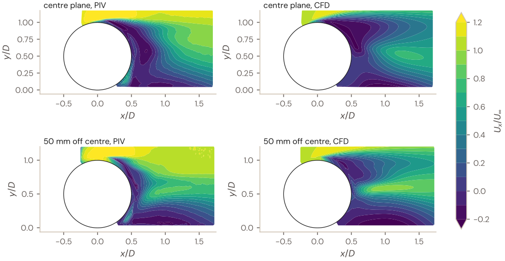
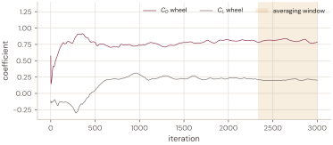
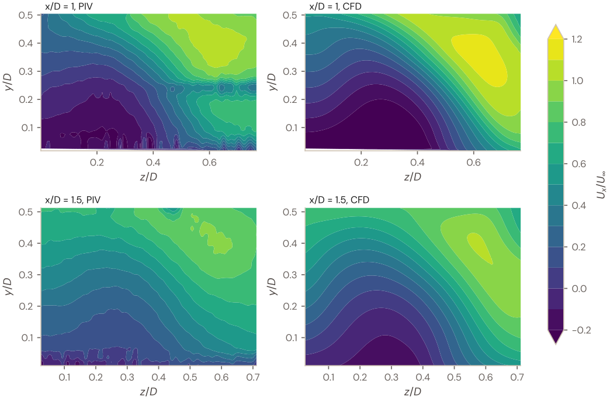

# Isolated rotating wheel (3D)

This case checks the 3D setup on the wake of a rotating wheel, against the PIV measurements of Patel,
Garmory and Passmore (2022): a half-scale racing tyre of 330 mm diameter at 30 m/s in four planes behind
the wheel. It tests the rotating wall and the contact patch with the floor.

Below axle height the computed wake has the measured shape; its width agrees within 10 % one and one and
a half diameters behind the axle. That is the part of the wake that matters for a wheel inside a wheel
arch, where it shapes the flow along the floor. The rotating wall and the contact-patch plinth work
without special treatment.



## Experiment

| | |
|---|---|
| Wheel | half scale, D = 330 mm, width 180 mm, smooth, rigid, on two pillow-block bearings on side supports |
| Drive | a drum flush with the fixed floor, no moving belt |
| Flow | 30 m/s (Re_D = 6.7·10⁵), turbulence intensity 0.2 %, blockage 3.3 % |
| Facility | Loughborough Large Wind Tunnel, working section 1.92 m × 1.32 m |
| Data | mean (and partly RMS) PIV in the centre plane, 50 mm beside it, and in cross planes 1 D and 1.5 D behind the axle; ±2 % uncertainty of the mean (99 % confidence) |

Forces and wall pressures were not measured. The only force values for comparison, from Fackrell (1974),
belong to a different wheel and are a plausibility check at most.

## Setup

The settings are those of the Ahmed case (k-ω SST, LUST, SIMPLEC, the same stop rules and averaging).
Geometry, boundary conditions and mesh sizes differ.

| Item | Choice | Reason |
|---|---|---|
| Geometry | rebuilt from the analytic surfaces in the text of the Parasolid file: tread R 165 mm, shoulder of two R 60 mm arcs, flat sidewall to R 99.5 mm, rim lip, hub face 14 mm deep | no Parasolid reader was available; the contact-patch vertices of the CAD file lie on the rebuilt surface within 0.001 mm |
| Contact patch | plinth (Diasinos et al. 2015): the footprint 1 mm above the floor, 45 × 129 mm, extruded into the floor | the wedge between tyre and floor cannot be meshed; Patel et al. used 0.1 mm with finer cells |
| Domain | half model, tunnel cross-section 1.32 × 0.96 m with slip walls, outlet 3.3 m behind the axle | |
| Floor | fixed wall from 3.65 m ahead of the axle | a flat-plate boundary layer then has about the measured displacement thickness of 7 mm at the wheel |
| Wheel | wheel, rim, plinth and shaft rotate as a wall at 181.8 rad/s | the bottom of the tread moves at freestream speed |
| Drum | part of the fixed floor | as in Patel et al.'s own validation computation |
| Mesh | cubes of 25.4 mm (the Ahmed mesh scaled to the wheel diameter), tyre surface 1.6 mm and 0.8 mm at curved parts, 3.2 mm box around the wheel and in the wake to 0.65 m behind the axle, 0.4 mm at the plinth; 5.97 million cells | |
| Wall | 4 layers of wall-function cells on wheel, supports and floor; y⁺ 0.6 to 134 on the wheel, 15 on average | nutUSpalding covers that range |

## Verification

The run swings by about ±4 % in the forces and does not settle within 3000 iterations. The fields are
averaged from iteration 400, the forces over the last 667 iterations. A grid study was not run: the
mesh needs about 2.8 GB of memory per million cells during generation, and a finer mesh did not fit on
the 32 GB server used. The numerical uncertainty of the wake is therefore not quantified.



## Comparison with the experiment

Mean streamwise velocity, CFD interpolated onto the PIV points (ΔU = U_CFD − U_PIV):

| Plane | Points | Mean ΔU/U∞ | RMS ΔU/U∞ | Share within ±5 % |
|---|---|---|---|---|
| centre plane | 77 188 | −0.22 | 0.38 | 23 % |
| 50 mm beside | 75 371 | −0.21 | 0.35 | 24 % |
| x/D = 1 | 15 502 | +0.02 | 0.16 | 26 % |
| x/D = 1.5 | 23 288 | −0.04 | 0.14 | 28 % |

Wake edge (U < 0.7 U∞):

| Quantity | Measured | CFD |
|---|---|---|
| top of the wake, centre plane, x/D = 1 | 0.94 D | > 1.15 D |
| top of the wake, centre plane, x/D = 1.5 | 0.45 D | > 1.15 D |
| half width at x/D = 1, height 0.1 D | 0.75 D | 0.65 D |
| half width at x/D = 1, height 0.3 D | 0.50 D | 0.48 D |
| half width at x/D = 1.5, height 0.1 / 0.3 D | 0.71 / 0.49 D | 0.64 / 0.49 D |

The origin of the centre planes is not documented in the PIV files. It was fitted to the masked outline
of the wheel, to within ±3 mm.



Computed forces (half model, frontal area of the wheel 0.0582 m²): wheel with shaft C_D = 0.81,
C_L = +0.21; supports C_D = 0.32. Fackrell's different wheel without shaft gave 0.58 and 0.44.

## Limits

- The upper wake. In the experiment the vortices on top of the wheel pull the wake down quickly, to
  0.45 D above the floor at 1.5 D behind the axle; the computed wake stays above 1.15 D. Patel et al. saw
  the same error, smaller, with IDDES. Steady RANS damps the vortices and averages the unsteady separation on top of the
  wheel, and wall functions on the curved, moving tread place that separation inaccurately. A run with
  resolved wall layers (y⁺ ≈ 1) on the wheel would separate the two causes.
- The forces of a rotating wheel: no open data set with an exact geometry was found.
- The grid uncertainty of the wake.

## Running it

The case needs no third-party files; for the PIV comparison see [SOURCES.md](SOURCES.md).

```
python cases/wheel/run_wheel.py mesh  --procs 16
python cases/wheel/run_wheel.py solve --procs 16
python cases/wheel/compare_piv.py --procs 16
```

The validated run took 1.6 s per iteration on 16 x86 cores (4750 s for 3000 iterations).
